# Documentação Técnica do Sistema de Busca Ativa, Comunicação Escolar & Livro de Atas Digital
**Colégio Estadual Leopoldina B. Pedroso — Ponta Grossa / Paraná**

---

## 1. Visão Geral

O **Sistema de Busca Ativa, Comunicação Escolar & Livro de Atas Digital** foi concebido e estruturado especificamente para a realidade operacional e jurídica do **Colégio Estadual Leopoldina B. Pedroso (Paraná)**. Ele integra a rotina pedagógica de contato rápido com famílias, combate preventivo ao abandono escolar, substituição oficial do caderno manuscrito de atas e interoperabilidade com os ecossistemas estaduais: **SERE (Sistema Estadual de Registro Escolar)**, **PRESENTE NA ESCOLA (Power BI)** e **SERP (Sistema Educacional da Rede de Proteção / Celepar)**.

### Objetivos do Projeto
- Substituir o uso de planilhas manuais e cadernos físicos por um banco de dados relacional íntegro na nuvem (**Neon PostgreSQL Serverless**) com fé pública institucional e integridade criptográfica.
- Permitir a **importação cadastral oficial em lote direto do SERE/SEED-PR** nos formatos nativos exportados pelo sistema estadual (`.xls` BIFF8, `.xlsx`, `.pdf` e `.csv`), mesclando turmas técnicas duplas e filtrando programas complementares.
- Prover um **Livro Oficial de Atas Pedagógicas Digital** juridicamente amparado pela **Lei Federal nº 14.063/2020**, **MP nº 2.200-2/2001**, **ECA** e **LGPD**, com numeração anual sequencial atômica, selo `SHA-256`, coleta de assinatura híbrida (tela ou QR Code móvel com biometria **WebAuthn/FIDO2**), termos de aditamento encadeados (*"Em tempo"*) e emissão do Livro Anual em PDF A4.
- Reduzir o tempo que a equipe pedagógica gasta redigindo comunicados e atas, oferecendo ditado por voz (`pt-BR`) e assistência generativa com **Google Gemini** (com JSON estruturado e *fallback* determinístico local).
- Prover **Fila Assistida por Turma via WhatsApp Web (`wa.me`)**, permitindo acionar múltiplos faltosos com reuso de guia única sem custos de API externa.
- Emitir **Dossiês Oficiais em PDF A4** auditados para o Conselho Tutelar, Ministério Público e SERP/FICAI, com anonimização automática de outros menores citados em atas conjuntas (Art. 17 e 143 do ECA).
- Prover uma **Extensão Chrome Multissistema (Manifest V3)** para extrair dados oficiais do Power BI e do SERP sem exigir credenciais da SEED-PR em servidores externos.

---

## 2. Arquitetura da Solução

```mermaid
flowchart TD
    User([Pedagoga / Administrador]) --> Browser[Navegador Desktop / Mobile PWA]
    Guardian([Responsável Legal - Smartphone]) --> MobileSign["/assinar/ata/:token (QR + WebAuthn Biometria)"]
    ExternalAuditor([Conselho Tutelar / MP / Família]) --> PublicValid["/validar/ata/:code (Certidão Cega LGPD)"]

    subgraph ClientSide [Navegador, PWA & Extensão Chrome]
        Browser --> NextApp[Next.js 16 App Router na Vercel]
        ExtLeopoldina["Extensão Leopoldina Sync (Manifest V3)"] -.->|Auto-scroll / DOM Extração| PowerBI["Power BI SEED-PR (Presente na Escola)"]
        ExtLeopoldina -.->|Main World Bridge paginar| SERPPortal["SERP / Rede de Proteção (Celepar)"]
        SereFiles["Relatórios SERE (.xls / .pdf / .csv)"] --> SereParser["Importador SERE (/alunos)"]
    end

    subgraph AuthSecurity [Camada de Segurança, Fé Pública & Governança]
        NextApp --> Proxy["src/proxy.ts - Middleware Global"]
        Proxy --> NextAuth["NextAuth.js v5 - Google OAuth @escola.pr.gov.br"]
        NextAuth --> Allowlist["Allowlist de Usuários (/equipe)"]
        Allowlist --> RBAC{Controle de Papéis}
        RBAC -->|ADMIN| AdminPrivileges[Gestão de Equipe + Auditoria + Edição/Saneamento]
        RBAC -->|PEDAGOGA| UserPrivileges[Busca Ativa + Atas + Prontuário 360º + Faltas + Dossiê]
    end

    subgraph BusinessLayer [Módulos da Aplicação]
        NextApp --> BuscaAtiva["/busca-ativa - Individual & Fila wa.me"]
        NextApp --> Atas["/atas - Livro Oficial de Atas Digital"]
        NextApp --> Prontuario["/alunos/:id - Prontuário 360º"]
        NextApp --> Dossie["/alunos/:id/dossie - Dossiê A4 ECA-safe"]
        NextApp --> Faltas["/faltas - Frequência, Queda Abrupta e SERP"]
        NextApp --> Alunos["/alunos - Base Cadastral & Sync SERE"]
        NextApp --> Boletim["/boletim - Diagnóstico Semanal Cron"]
        NextApp --> Modelos["/modelos - Editor & IA Gemini"]
        NextApp --> Historico["/historico - Controle Paginado & Triagem IA"]
        NextApp --> Relatorios["/relatorios - Indicadores SQL"]
        NextApp --> Auditoria["/auditoria - Trilha Imutável com IP"]
    end

    subgraph DataAndAI [Persistência, Criptografia & Inteligência]
        NextApp --> Prisma[Prisma ORM Client 6]
        MobileSign --> Prisma
        PublicValid --> Prisma
        SereParser --> Prisma
        Prisma --> NeonDB[(Neon PostgreSQL Serverless - AWS SP)]
        Atas --> CryptoHash["SHA-256 Canonical & Hash-Chaining (ataCrypto.ts)"]
        Atas --> GeminiAta["Google Gemini API - Formalização de Atas"]
        Modelos --> GeminiGen["Google Gemini API - Geração de Modelos"]
        Historico --> GeminiTriage["Google Gemini API - Classificação de Retornos"]
        ExtLeopoldina -->|POST Lote Bearer Token| SyncAPIs["/api/frequencia/sync & /api/serp/sync"]
        SyncAPIs --> Prisma
    end
```

---

## 3. Modelo de Dados Relacional (Prisma / PostgreSQL)

O banco de dados está hospedado no **Neon PostgreSQL Serverless (AWS São Paulo - `sa-east-1`)**, estruturado em [`prisma/schema.prisma`](../prisma/schema.prisma) com suporte multi-escola (`School`), prontuário 360º e livro oficial de atas imutável:

- **`School`**: Unidade escolar (`inepCode`, `name`, `city`, `state`, `nre`, `phone`, `email`, `logoUrl`, `settingsJson`) com garantia automática de existência via [`ensureDefaultSchool()`](../src/lib/currentSchool.ts).
- **`User`**: Servidores autorizados `@escola.pr.gov.br` (`role`: `ADMIN` | `PEDAGOGA`, `active`, `schoolId`).
- **`ClassGroup` & `Student`**: Turmas (`FUNDAMENTAL` | `MEDIO` | `NOTURNO`, turnos `MANHA` | `TARDE` | `NOITE`) e estudantes com `cgm` único, contatos e vínculos.
- **`StudentContact`**: Múltiplos responsáveis familiares (`kinship`, `phone`, `isPrimary`, `whatsappValid`).
- **`AbsenceJustification`**: Atestados médicos/odontológicos e dispensas legais com vigência (`startDate`, `endDate`, `cidCode`).
- **`AttendanceSnapshot` & `LowAttendanceRecord`**: Série histórica semanal de presença (`referenceWeek`), percentuais do Power BI e protocolo/status no SERP.
- **`MessageTemplate` & `MessageLog`**: Modelos dinâmicos e logs de disparos WhatsApp com `deliveryStatus` (`LINK_OPENED` | `SENT` | `FAILED_NO_WHATSAPP`) e triagem de retorno (`replyCategory`, `replyNotes`).
- **`PedagogicalMinute` (Livro Oficial de Atas)**:
  - Identificação e imutabilidade: `schoolId`, `year`, `ataNumber` (`@@unique([schoolId, year, ataNumber])`, `null` enquanto `DRAFT`), `status` (`DRAFT` | `FINALIZED` | `VOIDED`), `contentHash` (`SHA-256` canônico), `verificationCode` único não enumerável (`ATA-XXXX-XXXX`).
  - Conteúdo pedagógico: `category`, `isConfidential` (sigilo reforçado ECA), `attendedAt`, `subject`, `rawNotes`, `summary` (norma culta), `agreementsSummary`, `physicalSignedScanData`.
  - Fé pública e cancelamento: `authorId`, `authorName`, `authorEmail`, `authorRole`, `authorIp`, `finalizedAt`, `voidedAt`, `voidedByName`, `voidReason`.
- **`PedagogicalMinuteStudent`**: Vínculo N:N de estudantes à ata com *snapshot* imutável da época da lavratura (`studentNameSnapshot`, `classNameSnapshot`, `cgmSnapshot`), permitindo atas individuais ou conjuntas.
- **`PedagogicalMinuteParticipant`**: Signatários presentes (`role`, `name`, `documentType`, `documentNumber`, `documentVerifiedByStaff`, `signatureMode`, `signatureData`, `mobileSignToken`, `mobileSignExpiresAt`, `biometricVerified`, `biometricDeviceType`, `biometricAuthTime`, `refusalReason`, `witnessName`).
- **`PedagogicalMinuteAddendum`**: Termos de aditamento/retificação (*"Em tempo"*) com encadeamento criptográfico (`previousHash` $\rightarrow$ `addendumHash`).
- **`PedagogicalActionItem`**: Encaminhamentos estruturados pactuados na ata (`description`, `responsible`, `dueDate`, `status`, `completedAt`, `completedByName`).
- **`AuditLog`**: Trilha imutável de auditoria institucional com `action`, `entityType`, `entityId`, `userEmail`, `ipAddress` e `details`.

---

## 4. Módulos do Sistema & Interfaces

### 4.1. Painel de Busca Ativa (`/busca-ativa`)
1. **Envio Individual**: Seleção de Nível $\rightarrow$ Turma $\rightarrow$ Aluno, detecção automática de 🩺 **Atestado Vigente**, seletor de múltiplos contatos familiares e confirmação pós-abertura do `wa.me` (`SENT` ou `FAILED_NO_WHATSAPP`).
2. **Fila Assistida por Turma (`wa.me` Cadenciado)**: Seleção em lote com checkbox `:indeterminate`, desmarcação automática de alunos com atestado vigente ou já acionados no dia, barra `<progress>` nativa e reuso de aba única (`leopoldina_whatsapp_dispatch`).

### 4.2. Livro Oficial de Atas Pedagógicas Digital (`/atas`)
Projetado para substituir integralmente o caderno manuscrito com respaldo jurídico (Lei nº 14.063/2020 e MP nº 2.200-2/2001):
- **Editor Bimodal Widescreen (`AtaEditorModal.tsx` & `AtaDialog.tsx`)**:
  - **Ocupação horizontal plena** (`min(98vw, 1560px)`) com layout em duas colunas de alta legibilidade, sem uso de diálogos nativos bloqueáveis (`window.confirm`/`prompt`/`alert`).
  - **Etapa 1 (Alunos & Pauta)**: Assunto, categoria, flag de **Sigilo Reforçado (ECA)** e catálogo geral de estudantes com busca instantânea por nome/CGM/responsável, filtro por turma e suporte a múltiplos alunos em atas conjuntas.
  - **Etapa 2 (Redação Oficial & Assinaturas)**: Ditado por voz nativo (`pt-BR`) + botão **"Formalizar com IA"** (Gemini), editor serifado de texto formal, quadro de encaminhamentos com prazos e coleta híbrida de assinaturas.
- **Coleta Híbrida de Assinaturas & Biometria WebAuthn**:
  - **Assinatura em Tela (`<canvas>`)**: Coleta de traço manuscrito direto no computador/tablet da escola com atesto de documento conferido presencialmente pela servidora (fé pública).
  - **Assinatura via QR Code Móvel + Biometria (`/assinar/ata/[token]`)**: Gera token temporário de uso único (expiração de 20 min); o responsável escaneia com o próprio celular, autentica sua identidade via biometria local do aparelho (**WebAuthn / Passkey FIDO2 — TouchID, FaceID ou Biometria Android**, sem transmitir dados biométricos brutos, em estrita conformidade com a LGPD) e assina na tela do smartphone, com atualização em tempo real (*polling*) no computador da pedagoga.
  - **Termo de Recusa Inline**: Caso o presente recuse assinar, registra-se o motivo e a testemunha escolar presencial com fé pública.
- **Lavratura Atômica, Imutabilidade & Pós-Lavratura**:
  - Ao clicar em **"Lavrar Ata Oficial (Imutável)"**, o endpoint `/api/atas/[id]/finalize` sincroniza os dados finais, atribui atomicamente o próximo `ataNumber` anual da escola (com proteção contra concorrência `P2002` e transação estendida para *cold-start* serverless) e sela o registro com **Hash `SHA-256` canônico**.
  - Após lavrada, nenhuma edição ou exclusão é permitida (`403 Forbidden`). Eventuais correções materiais ocorrem exclusivamente via **Termo de Aditamento ("Em tempo")** com *hash-chaining*, ou **Averbação de Cancelamento ("Tornada Sem Efeito")** mediante justificativa auditada.
- **Impressão A4, Certidão Pública e Livro Anual**:
  - **Via Oficial A4 (`/atas/[id]/imprimir`)**: Documento formatado com brasão/cabeçalho SEED-PR, assinaturas coletadas, selo de autenticação biométrica, hash `SHA-256` e QR Code de verificação.
  - **Certidão Pública Cega LGPD (`/validar/ata/[code]`)**: Permite a qualquer órgão externo (Conselho Tutelar, MP, NRE) validar a autenticidade e integridade da ata sem expor dados sensíveis de menores (nomes e documentos mascarados via `maskName`/`maskDocument`).
  - **Livro Anual Consolidado (`/atas/livro/[ano]`)**: Emite o caderno anual completo com **Termo de Abertura**, todas as atas numeradas em ordem sequencial, adendos/averbações e **Termo de Encerramento** para arquivo permanente na secretaria escolar / e-Protocolo.

### 4.3. Base de Alunos & Importação SERE (`/alunos`)
- Gerenciamento completo de estudantes, turmas e indicadores cadastrais.
- **Assistente de Importação SERE (`SereImportModal.tsx` + `sereParser.ts`)**:
  - Aceita múltiplos arquivos simultâneos nos formatos oficiais exportados pelo SERE/SEED-PR: **planilhas `.xls` nativas (BIFF8) / `.xlsx`** (via `xlsx`), **relatórios `.pdf`** (via `unpdf`) e **arquivos `.csv`** (detecção automática `UTF-8` / `Windows-1252`).
  - Unifica automaticamente turmas técnicas duplas e ignora matrículas de programas complementares/contraturno (AEE, Mais Aprendizagem, Edutech, Robótica, PMA, etc.), preservando apenas a turma regular principal.
  - Exibe prévia detalhada de novos alunos, atualizações cadastrais e transferências antes de efetivar a sincronização auditada em lote (`/api/students/import`).

### 4.4. Prontuário 360º (`/alunos/[id]`) & Dossiê Oficial PDF (`/alunos/[id]/dossie`)
- **Prontuário 360º**: Centraliza indicadores de frequência, múltiplos contatos, atestados vigentes, linha do tempo de WhatsApp e integração direta com o **Livro Oficial de Atas Digital** (permitindo lavrar novas atas, finalizar rascunhos ou consultar atas/adendos do estudante).
- **Dossiê Oficial A4**: Relatório técnico auditado para Conselho Tutelar / MP / SERP contendo todas as buscas ativas (incluindo tentativas frustradas por número sem WhatsApp), atestados e atas oficiais lavradas. Conta com controles de conformidade **ECA (Art. 17 e 143)**: ocultação por padrão de atas com **Sigilo Reforçado** e **anonimização automática por iniciais** de outros estudantes mencionados em atas conjuntas (`anonymizeOtherMinorsInText`).

### 4.5. Painel de Infrequência & SERP (`/faltas`)
- Monitoramento em tempo real com chips de risco, detector preventivo de **📉 Queda Abrupta**, drawer lateral de acionamento rápido e sincronização via Extensão Chrome.

### 4.6. Histórico Paginado (`/historico`), Relatórios (`/relatorios`) & Boletim Semanal (`/boletim`)
- **Histórico**: Paginação *server-side*, filtros combinados e triagem de retornos familiares com Gemini AI.
- **Relatórios**: Agregações SQL nativas (`count` + `groupBy`) por trimestre/período, motivos, pedagogas e causas de ausência.
- **Boletim Semanal**: Rotina automatizada via Vercel Cron (`0 10 * * 1`) destacando alunos críticos (<75%) sem contato recente, casos SERP e taxas de resposta.

### 4.7. Gestão de Equipe (`/equipe`) & Auditoria (`/auditoria`)
- Controle administrativo estrito (*allowlist*) de servidores `@escola.pr.gov.br`, consolidação de registros legados (`scripts/consolidate_users.cjs`) e trilha completa de auditoria com IP.

---

## 5. Inteligência Artificial com Google Gemini (`@google/genai`)

1. **Formalização Jurídico-Pedagógica e Revisão Gramatical de Atas (`/api/ai/formalize-ata` & `src/lib/nreAtaFormatter.ts`)**:
   - Converte anotações rápidas, transcrições de voz ou aprimora minutas já redigidas pela equipe pedagógica, atuando como corretor ortográfico, sintático e de concordância verbal/nominal.
   - Aplica com rigor as **Diretrizes Oficiais do NRE/SEED-PR**:
     - **Texto Corrido Contínuo:** Redação em bloco único e contínuo, sem quebras de linha (`\n`), parágrafos em branco ou tópicos/bullets, prevenindo espaços livres suscetíveis a entrelinhas ou interpolações fraudulentas.
     - **Tempo Verbal Canônico:** Emprego estrito do Pretérito Perfeito do Indicativo (*"reuniram-se"*, *"deliberou-se"*, *"declarou"*, *"acordaram"*).
     - **Grafia Oficial:** Números e horas redigidos preferencialmente por extenso (*"duas faltas consecutivas"*, *"às catorze horas e trinta minutos"*).
     - **Linguagem Oficial e ECA-Safe:** Vedadas abreviaturas informais; preservação da integridade moral e psicológica do estudante segundo o Estatuto da Criança e do Adolescente.
     - **Fechamento e Reconhecimento:** Cláusula canônica expressando que a ata foi lida, conferida e achada conforme por todos os presentes.
   - Suporte a refinamento incremental: caso o usuário já tenha iniciado a minuta formal, a IA preserva o conteúdo manual enquanto corrige pontuação, ortografia e alinha às regras do NRE.
   - Retorna JSON estruturado com `formalSubject`, `formalSummary` (texto corrido único), `agreementsSummary` e sugestão de `actionItems` com prazos, dispondo de *fallback* determinístico offline homologado em [`src/lib/nreAtaFormatter.ts`](../src/lib/nreAtaFormatter.ts).
2. **Geração de Modelos Institucionais (`/api/ai/generate-template`)**:
   - Cria modelos acolhedores de comunicados estruturados (`title`, `prefixText`, `suffixText`, `isAbsenceRelated`).
3. **Classificação & Formalização de Retorno Familiar (`/api/ai/classify-reply`)**:
   - Resume relatos informais de WhatsApp em linguagem formal e classifica a causa (`SAUDE`, `TRANSPORTE`, `TRABALHO`, `VIAGEM_FAMILIAR`, `VULNERABILIDADE`, `SEM_JUSTIFICATIVA`, `OUTROS`), sinalizando necessidade de atestado médico.

---

## 6. Rotas de API e Endpoints

| Método | Rota | Autenticação | Descrição |
| :--- | :--- | :--- | :--- |
| `GET/POST` | `/api/atas` | Sessão Web | Listagem filtrada do Livro de Atas e criação de rascunhos com sanitização automática. |
| `GET/PATCH/DELETE` | `/api/atas/:id` | Sessão Web | Consulta, atualização de rascunho (preservando tokens/assinaturas móveis) e descarte de rascunhos (`403` se lavrada). |
| `POST` | `/api/atas/:id/finalize` | Sessão Web | Sincronização atômica final, numeração anual sequencial, geração de `verificationCode` e selagem `SHA-256`. |
| `POST` | `/api/atas/:id/addendums` | Sessão Web | Lavratura de Termo de Aditamento (*"Em tempo"*) com *hash-chaining* criptográfico. |
| `POST` | `/api/atas/:id/void` | Sessão Web | Averbação auditada para tornar ata lavrada sem efeito administrativo. |
| `PATCH` | `/api/atas/:id/actions/:actionId` | Sessão Web | Atualização de status (`PENDING` / `COMPLETED`) de encaminhamentos pactuados na ata. |
| `POST` | `/api/atas/:id/sign-token` | Sessão Web | Emissão de link/QR Code temporário (20 min) para assinatura móvel do participante. |
| `GET/POST` | `/api/atas/sign-token/:token` | Token Único | Consulta pública restrita ao signatário e submissão de assinatura móvel + prova biométrica WebAuthn. |
| `GET` | `/api/atas/public/:code` | Pública (LGPD) | Verificação pública mascarada de autenticidade e integridade da ata pelo código do QR Code. |
| `POST` | `/api/ai/formalize-ata` | Sessão Web | Formalização de ata escolar e extração de encaminhamentos com Google Gemini. |
| `POST` | `/api/students/import` | `ADMIN` / Sessão | Importação e sincronização cadastral em lote a partir de relatórios do SERE (`.xls`/`.pdf`/`.csv`). |
| `GET/POST/PUT/DELETE` | `/api/students` | Sessão / `ADMIN` | Gestão cadastral de estudantes e turmas. |
| `POST` | `/api/students/:id/contacts` | Sessão Web | Gestão de múltiplos contatos familiares do aluno. |
| `POST` | `/api/students/:id/justifications` | Sessão Web | Registro de atestados médicos e justificativas com vigência. |
| `POST` | `/api/students/:id/attendances` | Sessão Web | Registro legado de comparecimento presencial simples. |
| `POST` | `/api/messages/send` | Sessão Web | Registro de disparo WhatsApp e geração de URL `wa.me`. |
| `PATCH` | `/api/messages/status` | Sessão Web | Confirmação de entrega (`SENT`) ou invalidação cadastral (`FAILED_NO_WHATSAPP`). |
| `POST` | `/api/messages/reply` | Sessão Web | Registro de retorno familiar e categoria de causa. |
| `GET` | `/api/messages` | Sessão Web | Histórico paginado com filtros *server-side*. |
| `PUT/DELETE` | `/api/messages/manage` | `ADMIN` | Saneamento administrativo auditado de registros de mensagens. |
| `POST` | `/api/ai/classify-reply` | Sessão Web | Triagem e formalização de justificativas familiares com Gemini AI. |
| `POST` | `/api/ai/generate-template` | Sessão Web | Geração de modelos institucionais com Gemini AI. |
| `POST` | `/api/ai/test-key` | Sessão Web | Teste de conectividade de chave da API Gemini. |
| `POST` | `/api/frequencia/sync` | Bearer / Sessão | *Batch upsert* de frequência e snapshots semanais do Power BI. |
| `POST` | `/api/serp/sync` | Bearer / Sessão | *Batch upsert* de protocolos do portal SERP/Celepar. |
| `GET/POST` | `/api/cron/weekly-digest` | `CRON_SECRET` / Sessão | Geração automática do Boletim Executivo Semanal. |

---

## 7. Escala, PWA & Rotinas Automatizadas

- **PWA Mobile Instalável (`ESC-02`)**: Web App Manifest (`public/manifest.json`), Service Worker (`public/sw.js`) com bypass seguro para `/api/*`, ícones adaptativos e banner `PwaRegister.tsx`.
- **Boletim Semanal Automatizado (`ESC-03`)**: Agendamento `0 10 * * 1` em `vercel.json` e painel `/boletim` pronto para impressão A4.
- **Multi-Escola (`ESC-01`)**: Isolamento por `School` (INEP) com provisão automática da escola padrão (`ensureDefaultSchool`) para integridade referencial em novos deploys.

---

## 8. Qualidade, Testes & Conformidade Jurídica

- **Suíte de Testes Automatizados (Vitest — 41 testes em 7 arquivos, 100% de aprovação)**:
  - `src/lib/__tests__/ataCrypto.test.ts` (6 testes): Determinismo e sensibilidade a adulteração do hash `SHA-256`, *hash-chaining* de adendos, códigos de verificação, mascaramento LGPD e anonimização ECA de terceiros menores.
  - `src/lib/__tests__/sereParser.test.ts` (6 testes): Extração real de buffers `.xls` (BIFF8), `.pdf` e `.csv` (UTF-8/Latin1), mesclagem de turmas técnicas e exclusão de turmas de contraturno.
  - `src/lib/__tests__/messageFormatter.test.ts` (8 testes): Interpolação de tags dinâmicas e saudações por turno.
  - `src/lib/__tests__/studentMatcher.test.ts` (8 testes): Pareamento `O(1)` por CGM e nome normalizado sem acentos.
  - `src/lib/__tests__/pedagogicalClassifier.test.ts` (6 testes): Detecção de queda abrupta e vigência de atestados.
  - `src/lib/__tests__/whatsappPhase4.test.ts` (4 testes): Fila assistida, saneamento de números e classificação de retornos.
  - `src/lib/__tests__/phase5Features.test.ts` (3 testes): Contexto multi-escola e interpolação institucional.
- **Conformidade Legal (Lei nº 14.063/2020, MP 2.200-2/2001, ECA e LGPD)**:
  - Assinatura eletrônica institucional qualificada pela fé pública do servidor autenticado via `@escola.pr.gov.br` + IP + timestamp.
  - Assinatura eletrônica avançada dos responsáveis via posse do dispositivo + autenticação biométrica FIDO2/WebAuthn local (nenhum dado biométrico deixa o smartphone do cidadão) + integridade `SHA-256`.
  - Proteção integral à intimidade da criança e do adolescente (ECA Art. 17 e 143) em atas sigilosas, dossiês individuais e certidões públicas mascaradas.
